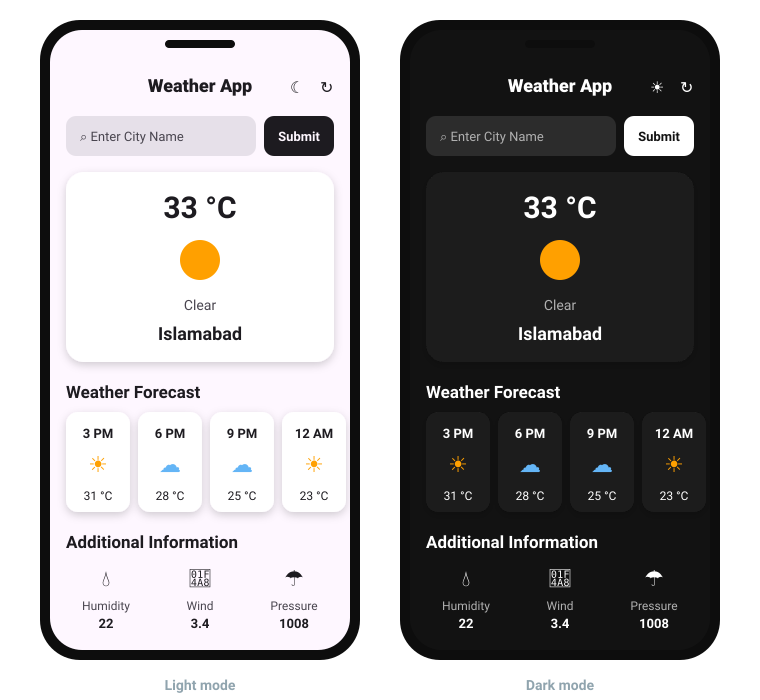
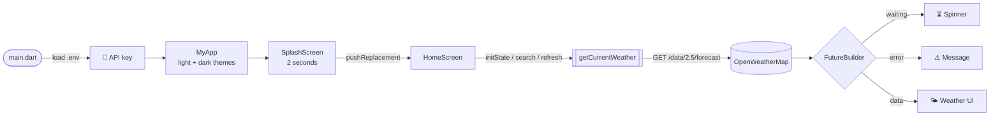
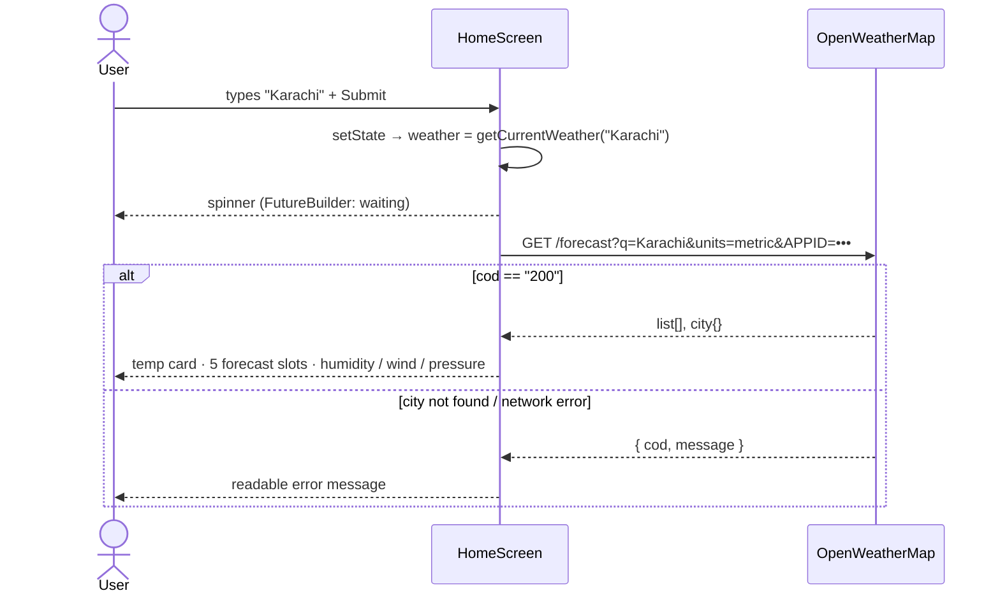

<div align="center">



<br/>


# Weather App

**Type a city. Get the sky.**
A clean, fast Flutter app that pulls live weather and a short-range forecast from the OpenWeatherMap API — with light & dark mode built in.

<p>
  
  
  
  
</p>
<p>
  
  
  
  
</p>

[Features](#-features) · [Preview](#-preview) · [How it works](#-how-it-works) · [Getting started](#-getting-started) · [Project structure](#-project-structure) · [Roadmap](#-roadmap)

</div>

---

## ✨ Features

<table>
<tr>
<td width="50%" valign="top">

### 🔍 Search any city
Type a city name, hit **Submit** (or Enter) and the screen updates instantly. Opens on **Islamabad** by default.

### 🌡️ Current conditions
A frosted-glass card shows the temperature in °C, a weather icon, the condition and the city name.

### ⏱️ Forecast strip
A horizontally scrolling row with the next **5 forecast slots** (3-hour steps, ~15 hours ahead), times formatted like `3 PM`.

</td>
<td width="50%" valign="top">

### 💧 Extra details
Humidity, wind speed and pressure at a glance.

### 🌗 Light & dark mode
One tap toggles the theme across the whole app — no state-management package needed.

### 🔄 Refresh, loading & errors
Pull fresh data any time. A spinner shows while loading, and a readable message appears if a city isn't found or the network fails.

</td>
</tr>
</table>

> 🚀 Plus a branded **splash screen**, a **custom launcher icon**, and **widget tests** for every reusable component.

---

## 📱 Preview

<div align="center">


<sub>UI preview with sample data. Real values come live from OpenWeatherMap.</sub>
</div>

<!--
  📸 Add real screenshots / a demo GIF here, e.g.:
  | Splash | Light | Dark | Error |
  |:--:|:--:|:--:|:--:|
  |  |  |  |  |
-->

---

## 🧠 How it works

### App flow



### A request, step by step



### Engineering decisions

| Decision | Why it matters |
|---|---|
| **`ValueNotifier<ThemeMode>` + `ValueListenableBuilder`** | Global dark mode with no Provider/BLoC — the lightest tool that does the job. |
| **`Future` stored in state + `FutureBuilder`** | Search and refresh just assign a new `Future` inside `setState`. Loading, error and data states come for free. |
| **`pushReplacement` from the splash** | The back button never returns to the splash screen. A `mounted` check guards against navigating after dispose. |
| **`flutter_dotenv` for the API key** | The key lives in `.env`, which is gitignored. A `.env.example` shows contributors what to add. |
| **`Uri.https` with query params** | City names with spaces or special characters are encoded safely. |
| **Small reusable widgets** | `Heading`, `HourlyUpdate` and `AdditionalItem` keep the home screen readable and are each covered by a widget test. |

---

## 🛠️ Tech stack

| Layer | Tools |
|---|---|
| Framework | Flutter (Material 3), Dart |
| Networking | [`http`](https://pub.dev/packages/http) |
| Formatting | [`intl`](https://pub.dev/packages/intl) — times like `3 PM` |
| Config | [`flutter_dotenv`](https://pub.dev/packages/flutter_dotenv) |
| Branding | [`flutter_launcher_icons`](https://pub.dev/packages/flutter_launcher_icons) |
| Data | [OpenWeatherMap 5-day / 3-hour forecast API](https://openweathermap.org/forecast5) |
| Testing | `flutter_test` widget tests |

---

## 🚀 Getting started

**Prerequisites:** [Flutter SDK](https://docs.flutter.dev/get-started/install) (Dart ≥ 3.12) and a free [OpenWeatherMap API key](https://home.openweathermap.org/api_keys).

```sh
# 1. Clone
git clone https://github.com/RafayAijaz/Weather-App.git
cd Weather-App

# 2. Add your API key
cp .env.example .env
#    then edit .env →  WEATHER_API_KEY=your_openweathermap_api_key

# 3. Install & run
flutter pub get
flutter run
```

> 💡 New OpenWeatherMap keys can take up to a couple of hours to activate. If you see `Invalid API key`, wait and try again.

### Run the tests

```sh
flutter test
```

| Test | Checks |
|---|---|
| `Heading shows its text` | Renders the given title |
| `HourlyUpdate shows hour, icon and temperature` | Time label, weather icon and °C value |
| `AdditionalItem shows icon, label and value` | Icon, property name and reading |

---

## 📂 Project structure

```text
lib/
├── main.dart              # Loads .env, global themeNotifier, MaterialApp (light/dark)
├── splash_screen.dart     # Logo for 2s → pushReplacement to HomeScreen
├── home_screen.dart       # Search, refresh, API call, FutureBuilder UI
└── widgets/
    ├── heading.dart        # Section title
    ├── hourly_update.dart  # One forecast slot card
    └── additional_item.dart# Humidity / wind / pressure tile
test/
└── widget_test.dart       # Widget tests for all three components
assets/images/icon.png     # App + splash icon
.env.example               # Template for WEATHER_API_KEY
```

---

## 🗺️ Roadmap

- [ ] 📍 Use device location for the default city
- [ ] 🌧️ Richer condition icons (rain, snow, storm, night) and animated backgrounds
- [ ] 📅 Full 5-day view grouped by day
- [ ] 💾 Remember the last searched city and theme choice
- [ ] 🧱 Move API logic into a repository + model classes, add unit tests with a mocked client
- [ ] 🔐 Route requests through a small backend proxy so the API key never ships inside the app bundle
- [ ] ⚙️ GitHub Actions CI: `flutter analyze` + `flutter test` on every push

---

## 🧾 Commit history

Built in small, focused commits — each one does a single thing:

```text
741613c  add splash screen
67acc1a  add env file
38aaf9a  add launcher icons
d33585c  ignore .env variants and reformat home screen
3dd9555  add env example, internet permission, README and widget tests
```

---

## 🙏 Acknowledgements

- Weather data by [OpenWeatherMap](https://openweathermap.org/)
- Built with [Flutter](https://flutter.dev/)

<div align="center">

---

### 👤 Author

**Rafay Aijaz** — Flutter Developer · Cyber Security student

[](https://github.com/RafayAijaz)

⭐ **If you like this project, give it a star — it really helps!**

</div>
