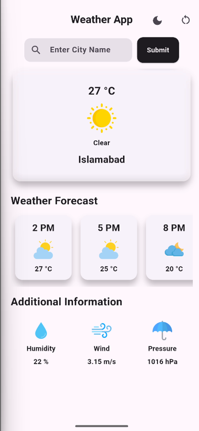
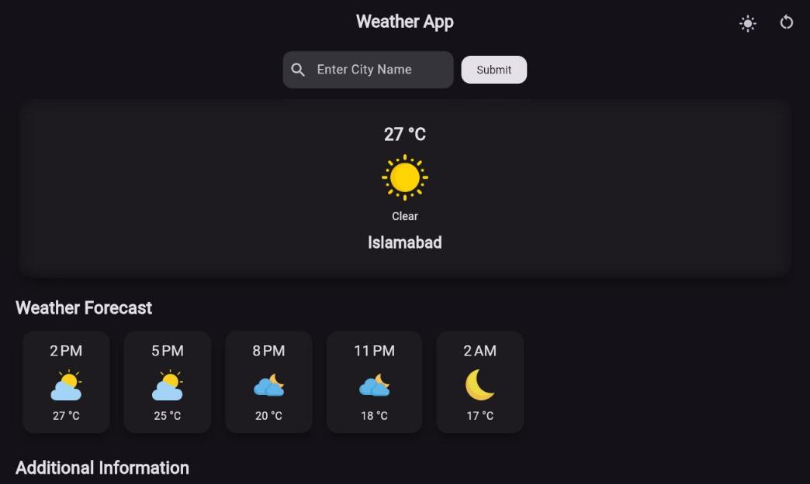
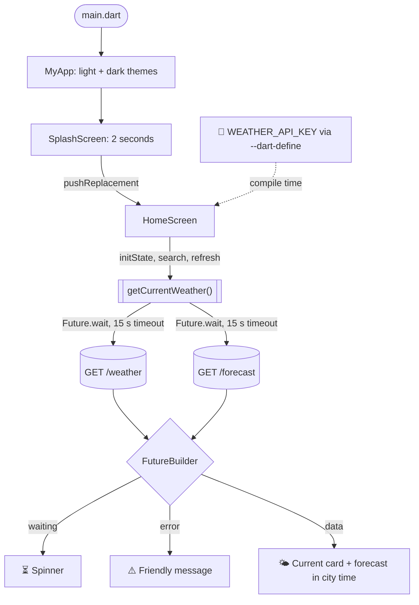
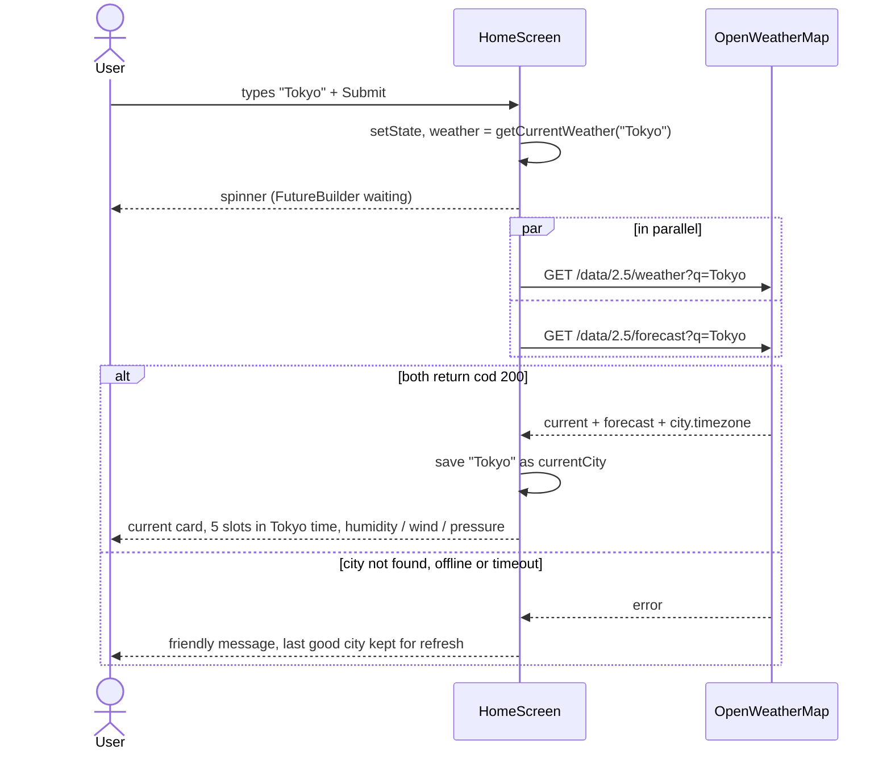
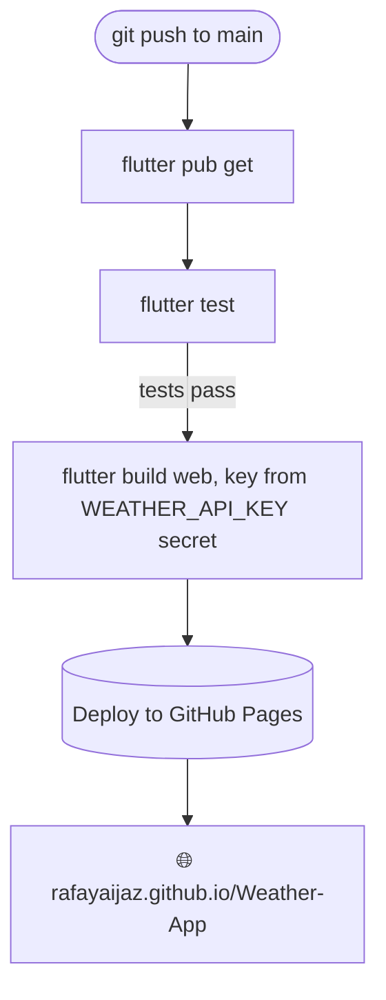

<div align="center">



<br/>


# Weather App

**Type a city. Get the sky.**
A clean Flutter app that shows real current conditions and a 15-hour forecast for any city on Earth, in that city's own local time, with light & dark mode built in.

### 🌐 [Try the live demo →](https://rafayaijaz.github.io/Weather-App/)

<p>
  
  
  
  
</p>
<p>
  <a href="https://github.com/RafayAijaz/Weather-App/actions/workflows/deploy.yml"></a>
  <a href="https://rafayaijaz.github.io/Weather-App/"></a>
  
  
  
</p>

[Features](#-features) · [Preview](#-preview) · [How it works](#-how-it-works) · [Getting started](#-getting-started) · [CI/CD](#%EF%B8%8F-cicd) · [Project structure](#-project-structure) · [Roadmap](#%EF%B8%8F-roadmap)

</div>

---

## ✨ Features

<table>
<tr>
<td width="50%" valign="top">

### 🔍 Search any city
Type a city name, hit **Submit** (or Enter) and the screen updates. Opens on **Islamabad** by default.

### 🌡️ Real current conditions
The top card uses OpenWeather's **current-weather** endpoint, so it shows the weather *right now*, not a forecast slot up to 3 hours ahead.

### ⏱️ 15-hour forecast
The next **5 forecast slots** (3-hour steps), shown in the **searched city's local time**. Search Tokyo from Karachi and you see Tokyo hours.

### 🌙 Day & night icons
Each card reads its own OpenWeather icon code (`…d` = day, `…n` = night), so a cloudy 8 PM shows a moon behind the cloud. Clear, clouds, rain, drizzle, thunderstorm and snow each have their own image; mist, haze and fog fall back to a neutral cloud.

</td>
<td width="50%" valign="top">

### 💧 Extra details, with units
Humidity in **%**, wind in **m/s**, pressure in **hPa**.

### 🌗 Light & dark mode
One tap toggles the theme across the whole app, with no state-management package needed.

### 🔄 Refresh that stays correct
The city name is saved **only after a successful request**, so a typo never breaks the refresh button.

### 💬 Friendly errors
*"No internet connection…"*, *"The request timed out…"* and *"API key is missing…"* replace raw exception text. Requests time out after 15 seconds.

</td>
</tr>
</table>

> 🚀 Plus a branded **splash screen**, a **custom launcher icon**, 11 custom **image icons**, **widget tests**, and a **CI/CD pipeline** that tests, builds and deploys the web app on every push.

---

## 📱 Preview

<div align="center">

| ☀️ Light mode | 🌙 Dark mode |
|:--:|:--:|
|  |  |

<sub>Real screenshots from the app running on a phone. Note the forecast switching from day icons (2 PM, 5 PM) to a night icon (8 PM).<br/>Want to try it yourself? Open the <a href="https://rafayaijaz.github.io/Weather-App/">live web demo</a>.</sub>

</div>

<!--
  🎬 Add a demo GIF or phone screenshots here, e.g.:
  
-->

---

## 🧠 How it works

### App flow



### A search, step by step



### Engineering decisions

| Decision | Why it matters |
|---|---|
| **Two endpoints with `Future.wait`** | `/weather` gives true current conditions, `/forecast` gives the strip. Both run in parallel, so it costs no extra wait. |
| **City time zone, not device time zone** | Forecast times use `dt + city.timezone` as UTC, so hours are correct for the searched city wherever the user is. |
| **Icon from the icon code suffix** | `d`/`n` in OpenWeather's icon code decides day or night per slot, instead of guessing from the clock. |
| **Save the city only on success** | A misspelled search can't poison the refresh button. |
| **`--dart-define` instead of a bundled `.env`** | The key is injected at build time. No `.env` file ships inside the app, and `flutter_dotenv` is gone. |
| **Typed error handling** | `TimeoutException` and `ClientException` become plain-English messages. |
| **`ValueNotifier<ThemeMode>`** | Global dark mode with no Provider/BLoC: the lightest tool that does the job. |
| **`Future` in state + `FutureBuilder`** | Search and refresh just assign a new `Future`. Loading, error and data states come for free. |
| **Small reusable widgets** | `Heading`, `HourlyUpdate` and `AdditionalItem` keep the screen readable and each has a widget test. |

---

## 🛠️ Tech stack

| Layer | Tools |
|---|---|
| Framework | Flutter (Material 3), Dart |
| Networking | [`http`](https://pub.dev/packages/http) |
| Formatting | [`intl`](https://pub.dev/packages/intl), times like `3 PM` |
| Branding | [`flutter_launcher_icons`](https://pub.dev/packages/flutter_launcher_icons) |
| Data | OpenWeatherMap [Current weather](https://openweathermap.org/current) + [5-day / 3-hour forecast](https://openweathermap.org/forecast5) |
| Testing | `flutter_test` widget tests |
| CI/CD | GitHub Actions → GitHub Pages |

---

## 🚀 Getting started

**Prerequisites:** [Flutter SDK](https://docs.flutter.dev/get-started/install) (Dart ≥ 3.12) and a free [OpenWeatherMap API key](https://home.openweathermap.org/api_keys).

```sh
# 1. Clone
git clone https://github.com/RafayAijaz/Weather-App.git
cd Weather-App

# 2. Add your API key
cp .env.example .env
#    then edit .env  →  WEATHER_API_KEY=your_openweathermap_api_key

# 3. Install & run
flutter pub get
flutter run --dart-define-from-file=.env
```

> ▶️ **VS Code:** just press **F5**. `.vscode/launch.json` already passes `--dart-define-from-file=.env`.

> 💡 New OpenWeatherMap keys can take up to a couple of hours to activate. If you see `Invalid API key`, wait and try again. If you see *"API key is missing"*, you ran without `--dart-define-from-file=.env`.

### Run the tests

```sh
flutter test
```

| Test | Checks |
|---|---|
| `Heading shows its text` | Renders the given title |
| `HourlyUpdate shows hour, icon and temperature` | Time label, weather image and °C value |
| `AdditionalItem shows icon, label and value` | Image icon, property name and reading |

---

## ⚙️ CI/CD

Every push to `main` runs [`.github/workflows/deploy.yml`](.github/workflows/deploy.yml):



If a test fails, nothing is deployed. The API key lives in the **`WEATHER_API_KEY` repository secret**, never in the code.

> 🔐 **Security note:** a web app's API key can still be seen in the browser's network tab. That's why this demo uses a **free key with no billing attached**. The proper fix (a small backend proxy) is on the roadmap.

---

## 📂 Project structure

```text
lib/
├── main.dart               # Global themeNotifier, MaterialApp (light/dark)
├── splash_screen.dart      # Logo for 2s → pushReplacement to HomeScreen
├── home_screen.dart        # Search, refresh, both API calls, icons, city time, UI
└── widgets/
    ├── heading.dart         # Section title
    ├── hourly_update.dart   # One forecast slot card
    └── additional_item.dart # Humidity / wind / pressure tile
test/
└── widget_test.dart        # Widget tests for all three components
assets/images/              # App icon + 11 weather & detail icons
.github/workflows/deploy.yml# Test → build web → deploy to Pages
.vscode/launch.json         # F5 runs with --dart-define-from-file=.env
.env.example                # Template for WEATHER_API_KEY
```

---

## 🗺️ Roadmap

- [x] 🌙 Day/night aware icons for every condition
- [x] 🌍 Forecast in the searched city's time zone
- [x] ⚙️ GitHub Actions: test, build and deploy on every push
- [x] 🔑 API key via `--dart-define` and a repository secret
- [ ] 📍 Use device location for the default city
- [ ] 📅 Full 5-day view grouped by day
- [ ] 💾 Remember the last searched city and theme choice
- [ ] 🧱 Move API logic into a repository + model classes, add unit tests with a mocked client
- [ ] 🔐 Route requests through a small backend proxy so the key never reaches the client
- [ ] 🔎 Add `flutter analyze` to the pipeline

---

## 🧾 Commit history

Built in small, focused commits:

```text
741613c  add splash screen
67acc1a  add env file
38aaf9a  add launcher icons
d33585c  ignore .env variants and reformat home screen
3dd9555  add env example, internet permission, README and widget tests
62c2726  add README banner and UI preview assets
08ce58c  fix flowchart rendering, mark platform folders as vendored
3cb1b1b  fix day/night forecast icons, use current weather API, add units and error handling
```

---

## 🙏 Acknowledgements

- Weather data by [OpenWeatherMap](https://openweathermap.org/)
- Built with [Flutter](https://flutter.dev/)

<div align="center">

---

### 👤 Author

**Rafay Aijaz** · Flutter Developer · Cyber Security student

[](https://github.com/RafayAijaz)

⭐ **If you like this project, give it a star. It really helps!**

</div>
